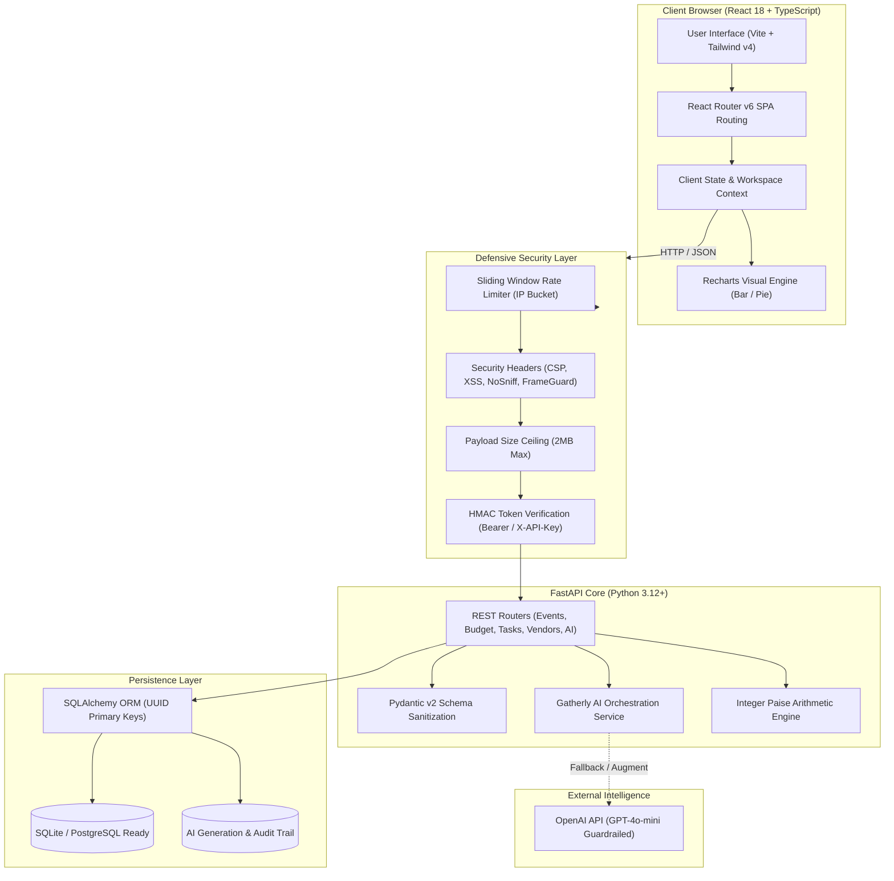
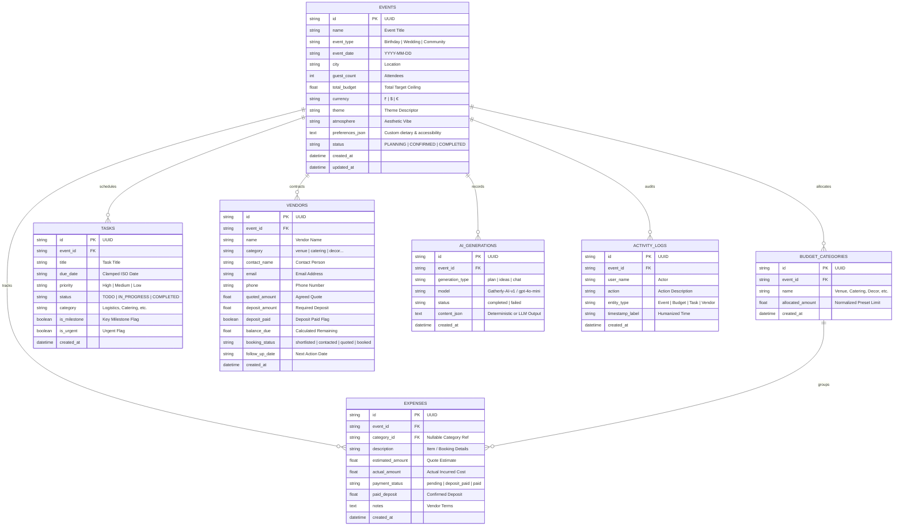
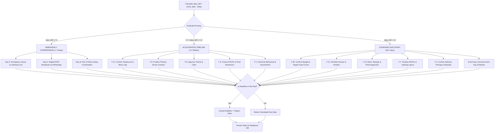

<div align="center">

# 🌿 Gatherly
### *World-Class AI Event Planner & High-Precision Production Workspace*

[](https://github.com/Rishisharma029/gatherly/actions/workflows/ci.yml)
[](https://github.com/Rishisharma029/gatherly/actions/workflows/docker.yml)
[](https://github.com/Rishisharma029/gatherly/actions/workflows/gh-pages.yml)
[](https://rishisharma029.github.io/gatherly/)
[](LICENSE)
[](https://www.python.org/)
[](https://fastapi.tiangolo.com/)
[](https://react.dev/)
[](https://www.typescriptlang.org/)
[](https://tailwindcss.com/)
[](SECURITY.md)

<p align="center">
  <strong>Gatherly</strong> is an editorial-grade, full-stack event workspace combining decimal-safe budget engineering, dynamic time-aware timeline compression, vendor lifecycle management, and practical Generative AI guidance.
</p>

[🚀 Explore Live Demo](https://rishisharma029.github.io/gatherly/) • [📖 API Documentation](#-api-contract-and-endpoints) • [🛡️ Security Policy](SECURITY.md) • [Report Bug](https://github.com/Rishisharma029/gatherly/issues)

</div>

---

> ### 🌐 Live Web Application
> **Gatherly is deployed and accessible at**:  
> **👉 [https://rishisharma029.github.io/gatherly/](https://rishisharma029.github.io/gatherly/)**  
> *Pre-configured with Aarav's 21st Birthday (₹25,000 budget ceiling, 30-day compressed timeline, vegetarian catering quotes, and black/gold aesthetic plan).*

---

## 📖 Table of Contents

- [Architectural Vision & Design Language](#-architectural-vision--design-language)
- [System Architecture](#-system-architecture)
- [Database Entity-Relationship Model (ERD)](#-database-entity-relationship-model-erd)
- [Dynamic Time-Aware Timeline Algorithm](#-dynamic-time-aware-timeline-algorithm)
- [Key Features Deep Dive](#-key-features-deep-dive)
  - [1. Decimal-Safe Smart Budgeting](#1-decimal-safe-smart-budgeting)
  - [2. Time-Aware Timeline & Checklist](#2-time-aware-timeline--checklist)
  - [3. Vendor Lifecycle Tracker](#3-vendor-lifecycle-tracker)
  - [4. Guardrailed Generative AI](#4-guardrailed-generative-ai)
- [Security Architecture & Hardening](#-security-architecture--hardening)
- [Docker & Containerized Deployment](#-docker--containerized-deployment)
- [Continuous Integration & CD Pipelines](#-continuous-integration--cd-pipelines)
- [API Contract and Endpoints](#-api-contract-and-endpoints)
- [Local Development Setup](#-local-development-setup)
- [Testing & Quality Assurance](#-testing--quality-assurance)
- [Code of Conduct & Contributing](#-code-of-conduct--contributing)

---

## 🎨 Architectural Vision & Design Language

Unlike generic AI demos with saturated purple gradients and fragile glassmorphism, Gatherly adheres to an **editorial productivity aesthetic** that feels like a bespoke planning atelier:

- **Warm Ivory (`#F8F7F2`)**: Restful, glare-free canvas background.
- **Deep Forest Green (`#1F5147`)**: Grounded executive primary tone for structure, action triggers, and primary headings.
- **Muted Apricot (`#E9A477`)**: Warm accent for interactive highlights, milestones, and pending actions.
- **Charcoal (`#252923`)**: High-contrast, optical-grade typography.
- **Bespoke Typography**: Paired `Playfair Display` (editorial serif headings) with `Plus Jakarta Sans` (ultra-legible geometric body).

```
#F8F7F2 ─── Canvas Background (Warm Ivory)
#1F5147 ─── Primary Brand (Deep Forest Green)
#E9A477 ─── Accent Highlight (Muted Apricot)
#252923 ─── Body Typography (Editorial Charcoal)
#E5E3DC ─── Subtle Card Bordering
```

---

## 🏛️ System Architecture

Gatherly implements a decoupled, production-ready full-stack topology:



---

## 🗃️ Database Entity-Relationship Model (ERD)

All tables utilize non-sequential `String(36)` UUID primary keys, enabling instant zero-downtime migration from SQLite to distributed PostgreSQL clusters:



---

## ⏱️ Dynamic Time-Aware Timeline Algorithm

Gatherly does not blindly output static 30-day schedules. The timeline engine inspects the runway between today and the event date, compressing and prioritizing milestones dynamically while **clamping deadlines to prevent impossible past dates**:



---

## 🌟 Key Features Deep Dive

### 1. Decimal-Safe Smart Budgeting
- **Integer Paise Arithmetic**: Currency values are converted to and computed as integers ($1\text{ Rupee} = 100\text{ paise}$).
  $$\text{Allocation Paise} = \left\lfloor \text{Total Budget} \times 100 \times \frac{\text{Preset Percentage}}{100} \right\rceil$$
- **100% Normalized Presets**: Birthday (30% catering, 20% venue, 15% decor, 10% entertainment, 8% media, 5% misc, 5% contingency, 4% attire, 3% invites).
- **Shortfall Intelligence**: When total actual costs exceed the total budget ceiling, an alert banner displays the exact deficit and generates category-level recommendations on where to trim.

### 2. Time-Aware Timeline & Checklist
- **Milestones vs. Tasks**: Visual indicator for key run-of-show milestones vs. daily action items.
- **Filterable Workspace**: Filter instantly by Priority (`High`, `Medium`, `Low`), Category (`Venue`, `Catering`, `Decor`, etc.), and Status (`TODO`, `IN_PROGRESS`, `COMPLETED`).
- **One-Click Completion**: Check off tasks directly from the dashboard or timeline with instantaneous progress recalculations.

### 3. Vendor Lifecycle Tracker
- **8 Standard Industry Categories**: Venue, Catering, Decoration, Photographer, Entertainment, Invitation/Printing, Transport, Miscellaneous.
- **Financial Status at a Glance**: Tracks Estimated Quote, Final Agreed Quote, Paid Deposit, and calculates Balance Due automatically:
  $$\text{Balance Due} = \max\left(0, \text{Final Quote} - \text{Paid Deposit}\right)$$
- **Status Pipeline**: Transitions from `shortlisted` $\to$ `contacted` $\to$ `quoted` $\to$ `booked`.

### 4. Guardrailed Generative AI
- **No Hallucinations**: Gatherly AI strictly distinguishes between user-entered estimates and confirmed vendor bookings. It never claims unverified phone numbers or addresses are real businesses.
- **Practical Trade-Off Explanations**: Ask Gatherly AI how to save money on a wedding or birthday, and it will recommend sensible substitutions (e.g. signature welcome spritz station vs. full open bar, focal photo walls vs. whole-room draping).

---

## 🛡️ Security Architecture & Hardening

Gatherly is hardened for production deployment:

| Protection | Implementation | Defense Capability |
|---|---|---|
| **Rate Limiting** | Sliding Window Token Bucket (`security.py`) | Prevents brute-force, scraping, and DoS (180 rpm general, 30 rpm AI). |
| **Security Headers** | `SecurityHeadersMiddleware` | Enforces `nosniff`, `DENY` clickjacking, XSS filtering, CSP, and Referrer rules. |
| **Payload Limiter** | Request Size Guard | Automatically rejects payloads exceeding 2MB with `413 Request Entity Too Large`. |
| **Tokenization Auth** | Cryptographic HMAC Timing-Safe Bearer Token | Prevents side-channel timing attacks via `hmac.compare_digest`. |
| **Input Validation** | Pydantic v2 Type Sanitization | Enforces strict ISO dates, non-negative budget constraints, and positive headcounts. |

---

## 🐳 Docker & Containerized Deployment

Run the entire Gatherly ecosystem (backend, frontend, proxy, and database) with a single command:

```bash
# Clone the repository
git clone https://github.com/Rishisharma029/gatherly.git
cd gatherly

# Spin up multi-container environment
docker compose up --build -d
```

### Container Services
- **`backend`**: Python 3.12-slim, non-root user `gatherly`, auto-migrating SQLite storage with integrated healthcheck (`http://localhost:8000/api/health`).
- **`frontend`**: High-performance multi-stage Nginx Alpine reverse-proxying `/api` requests to backend on port `80` and `5173`.

---

## 🔄 Continuous Integration & CD Pipelines

Three GitHub Actions workflows maintain continuous delivery:

1. **`ci.yml`**:
   - Executes Python 3.12 setup and full Pytest suite on every push and PR.
   - Executes Node 20 setup, `npm ci`, TypeScript typechecking (`tsc -b`), and Vite production bundling.
2. **`docker.yml`**:
   - Builds multi-stage Docker images for both backend and frontend to ensure zero container drift.
3. **`gh-pages.yml`**:
   - Compiles the frontend SPA with relative asset references and deploys directly to the `gh-pages` branch for static previewing.

---

## 📡 API Contract and Endpoints

| Method | Endpoint | Description | Status Code |
|---|---|---|---|
| `GET` | `/api/health` | Healthcheck & security status inspection | `200 OK` |
| `GET` | `/api/dashboard` | Aggregated dashboard KPI statistics and upcoming tasks | `200 OK` |
| `GET` | `/api/events` | List all events with calculated progress stats | `200 OK` |
| `POST` | `/api/events` | Create new event with date and budget validation | `200 OK` / `400` |
| `GET` | `/api/events/{id}` | Complete event detail with relational child records | `200 OK` / `404` |
| `PATCH`| `/api/events/{id}` | Partial event update (atmosphere, budget, guest count) | `200 OK` |
| `DELETE`| `/api/events/{id}` | Cascade delete event and all related entities | `200 OK` |
| `POST` | `/api/events/{id}/generate-plan` | Regenerate time-aware timeline and category presets | `200 OK` |
| `GET` | `/api/events/{id}/budget` | Category allocation limits, actual spend, and shortfalls | `200 OK` |
| `POST` | `/api/events/{id}/expenses` | Log individual expense record | `200 OK` |
| `PATCH`| `/api/expenses/{id}` | Update expense details or deposit status | `200 OK` |
| `DELETE`| `/api/expenses/{id}` | Remove expense record | `200 OK` |
| `GET` | `/api/events/{id}/tasks` | Filterable tasks (`status`, `priority`, `category`) | `200 OK` |
| `POST` | `/api/events/{id}/tasks` | Create task or milestone | `200 OK` |
| `PATCH`| `/api/tasks/{id}` | Update task completion status | `200 OK` |
| `DELETE`| `/api/tasks/{id}` | Remove task | `200 OK` |
| `GET` | `/api/events/{id}/vendors` | List vendor checklist records | `200 OK` |
| `POST` | `/api/events/{id}/vendors` | Create vendor quote and contact item | `200 OK` |
| `PATCH`| `/api/vendors/{id}` | Update vendor quote, deposit paid, or booking status | `200 OK` |
| `DELETE`| `/api/vendors/{id}` | Remove vendor record | `200 OK` |
| `POST` | `/api/events/{id}/ideas` | Generate bespoke themes, menus, and decoration plans | `200 OK` |
| `POST` | `/api/ai/chat` | Gatherly AI conversational guidance and trade-off advisor | `200 OK` |

---

## 💻 Local Development Setup

### 1. Prerequisites
- **Python**: 3.10 or higher
- **Node.js**: 18.0 or higher
- **Git**

### 2. Backend Setup
```powershell
# Navigate to backend directory
cd backend

# Create virtual environment
python -m venv venv

# Activate virtual environment
# Windows Powershell:
.\venv\Scripts\Activate.ps1
# macOS / Linux:
source venv/bin/activate

# Install requirements
pip install -r requirements.txt

# Start backend server
python -m uvicorn backend.app.main:app --host 127.0.0.1 --port 8000 --reload
```

### 3. Frontend Setup
```powershell
# In a separate terminal, navigate to frontend
cd frontend

# Install dependencies
npm install

# Start Vite dev server
npm run dev -- --port 5173
```

Access the application in your browser:
- **Frontend Workspace**: [http://127.0.0.1:5173](http://127.0.0.1:5173)
- **FastAPI Backend**: [http://127.0.0.1:8000](http://127.0.0.1:8000)
- **Interactive Swagger Docs**: [http://127.0.0.1:8000/docs](http://127.0.0.1:8000/docs)

---

## 🧪 Testing & Quality Assurance

Gatherly maintains a comprehensive Pytest test suite covering all CRUD operations, negative input validation guards, date-clamping logic, and security headers:

```powershell
# Run backend test suite
backend\venv\Scripts\python.exe -m pytest backend/tests -v

# Run frontend typecheck and build
cd frontend
npm run build
```

---

## 🤝 Code of Conduct & Contributing

We are committed to providing a welcoming, inclusive, and harassment-free experience for everyone. Please read our [Code of Conduct](CODE_OF_CONDUCT.md) and review our [Contributing Guidelines](CONTRIBUTING.md) before submitting pull requests.

---

## 📄 License

This project is licensed under the terms of the [MIT License](LICENSE).

<div align="center">
  <sub>Crafted with care for world-class planners everywhere.</sub>
</div>
